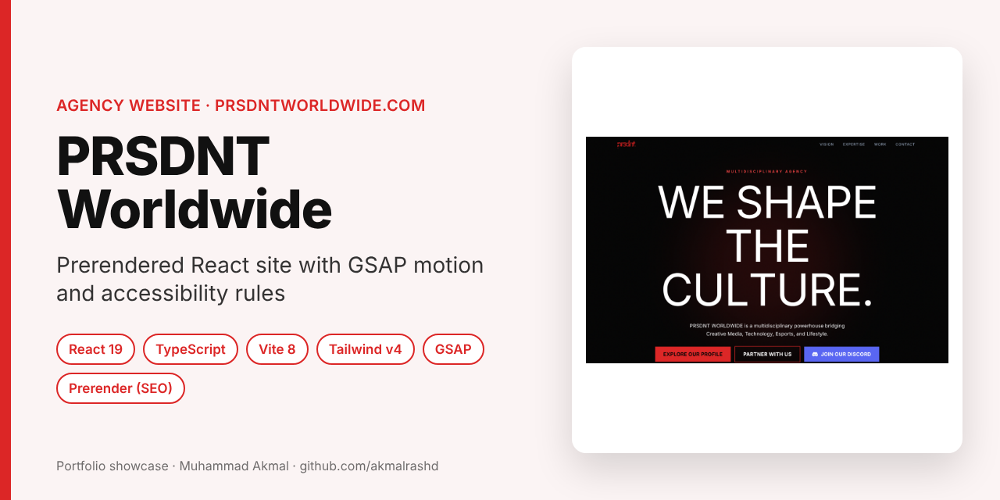
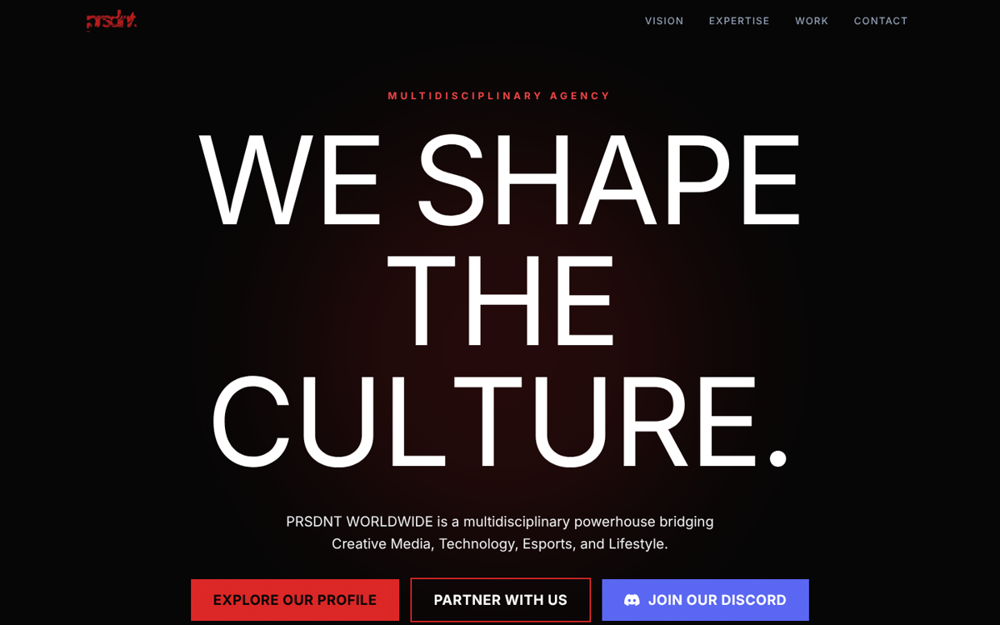
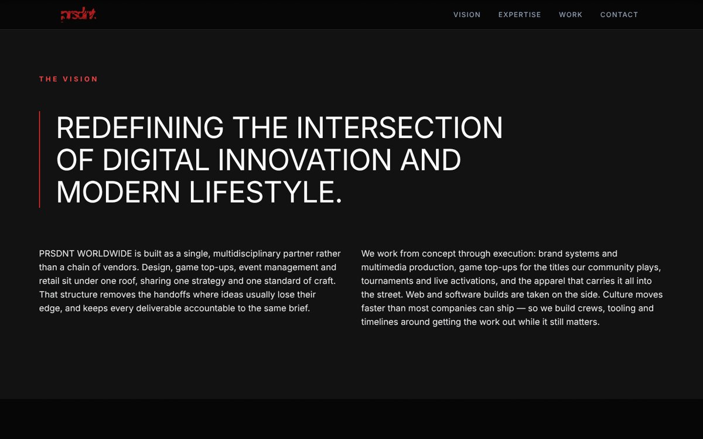
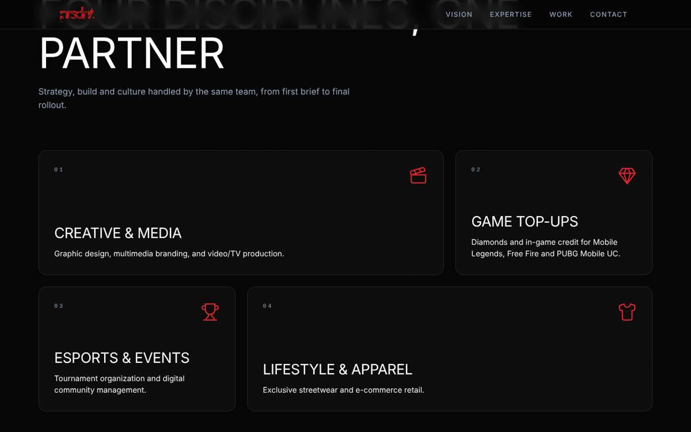
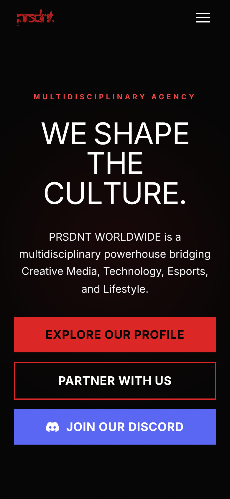
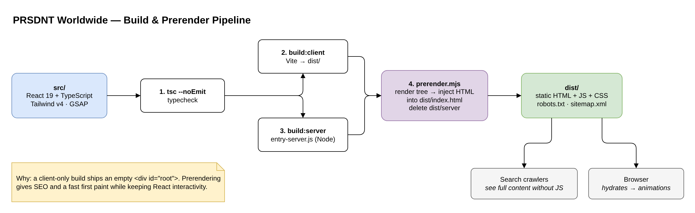
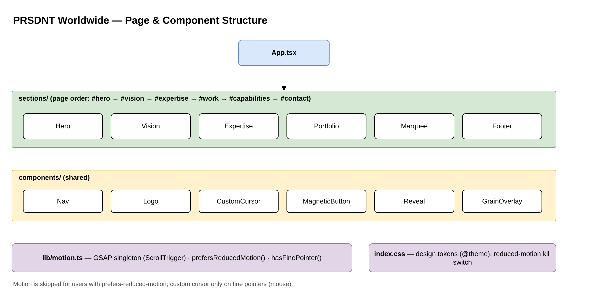

# PRSDNT Worldwide: Agency Website

> **Portfolio showcase.** Company profile site for PRSDNT WORLDWIDE, my freelance creative and esports brand. Source is private.

**Live:** prsdntworldwide.com · **Role:** Designer and developer · **Period:** July – October 2026

    

---

## What it is

A single-page, motion-rich company profile for a multidisciplinary agency (creative media, game top-ups, esports and events, lifestyle apparel). The goal was a bold look that still loads fast, ranks in search and respects accessibility settings.

## Screenshots

  
  
  

## System design

### Build and prerender pipeline

### Page and component structure

## Engineering highlights

- **Prerendered React:** a 4-step build (typecheck → client bundle → server bundle → prerender) injects real HTML into `index.html`, so crawlers and slow phones see content without waiting for JavaScript.
- **Motion with care:** one GSAP instance with ScrollTrigger; animations switch off for `prefers-reduced-motion`, and the custom cursor only appears on mouse devices.
- **Contrast rules in the design system:** brand red is measured against the background; the darker red is used only for large text and decoration, and a lighter red is used for normal text to pass WCAG AA.
- `robots.txt`, `sitemap.xml` and an Open Graph image for sharing.

## How I used AI tools

AI coding assistants helped with boilerplate, build scripts and debugging. The brand, layout, motion choices and content are mine.

## Contact

**Muhammad Akmal bin Mohd Rashid**: Software Engineering student, UMPSA.  
Open to a 6-month internship (22 February to 7 August 2027).  
📧 work.akmalrashd@gmail.com · 💼 [linkedin.com/in/akmalrashd](https://www.linkedin.com/in/akmalrashd)
